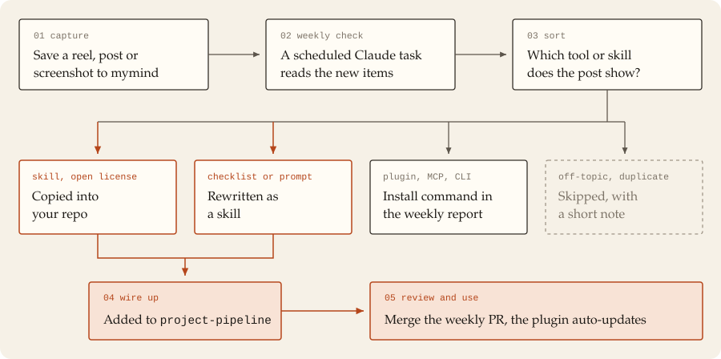

# claude-auto-kit-template

Save reels and posts about Claude Code skills to mymind. Once a week a Claude task reads that mymind space, finds the tool or skill behind each post and adds the useful ones to your own Claude Code plugin. You review the changes as a pull request; after you merge, Claude Code pulls the update on its own.

This repo is the template. Click **Use this template** and your copy fills up with your own finds. To see what a filled copy looks like, check the author's: [HCvCH/claude-auto-kit](https://github.com/HCvCH/claude-auto-kit).



## What you need

- [Claude Code](https://code.claude.com) with the `claude` CLI, and [git](https://git-scm.com) (Claude Code fetches the plugin with it)
- A [mymind](https://mymind.com) account (the free plan caps you at 100 cards at the time of writing, paid plans don't; see [pricing](https://mymind.com/pricing))
- A Claude plan with scheduled tasks and the mymind connector (Settings → Connectors)
- A GitHub account; Claude needs push access to your copy

## Setup

1. **Copy the repo.** Click **Use this template → Create a new repository**. Any name works, e.g. `claude-auto-kit`. If your copy is private, sign in to GitHub with git on your PC.
2. **Credit the original.** Keep [`NOTICE.md`](NOTICE.md) and put its credit line at the top of your README.
3. **Set your username** in two files. Don't add a `version` field, or auto-update stops working.
   - [`.claude-plugin/marketplace.json`](.claude-plugin/marketplace.json) → `owner.name`
   - [`plugins/auto-kit/.claude-plugin/plugin.json`](plugins/auto-kit/.claude-plugin/plugin.json) → `author.name`, `repository`
4. **Install your copy:**

   ```powershell
   claude plugin marketplace add <your-username>/<your-repo>
   claude plugin install auto-kit@auto-kit
   ```

5. **Turn on auto-update** so merged skills arrive by themselves. Add to `~/.claude/settings.json` (Windows: `C:\Users\<you>\.claude\settings.json`):

   ```json
   "extraKnownMarketplaces": {
     "auto-kit": {
       "source": { "source": "github", "repo": "<your-username>/<your-repo>" },
       "autoUpdate": true
     }
   }
   ```

6. **Load the pipeline in every project.** Add to your `CLAUDE.md`:

   ```text
   For every new project (website, web app, dashboard, 3D scene, motion video), start by loading the auto-kit:project-pipeline skill and follow its phases.
   ```

7. **Create a mymind space** (e.g. "AI") and share reels, posts and screenshots into it.
8. **Schedule the weekly check.** Fill in the placeholders in [`docs/weekly-check-prompt.md`](docs/weekly-check-prompt.md) (your repo, your space, the plugins and skills you already have) and schedule it in Claude. If a scheduled session can't push to your repo, run it as a weekly reminder in a chat with the repo attached. The prompt books its own next run.

The kit starts almost empty: `project-pipeline` (the orchestrator) and `video-pipeline` (its video router). The weekly check fills it from your saves. Want a head start? Copy skills from [HCvCH/claude-auto-kit](https://github.com/HCvCH/claude-auto-kit) and check each one's license first.

## How the weekly check works

1. mymind stores each link you share and writes an AI summary of it.
2. Claude reads every item in the space without the `claude-checked` tag. It uses that summary, tags, screenshots, web search and GitHub. It never scrapes Instagram or TikTok.
3. It sorts each find:
   - **Skill with an open license** (MIT, Apache-2.0 …) → copied into `plugins/auto-kit/skills/`, Markdown only
   - **Checklist or prompt** → rewritten as a skill in its own words
   - **Plugin, MCP server, CLI tool, connector** → install command in the report. These run code on your machine, so Claude never adds them itself
4. Each new skill gets a row in the "Skill bundles" table of [`project-pipeline`](plugins/auto-kit/skills/project-pipeline/SKILL.md) (phase, project types, mode: always / choose / if) and a sentence in the text of its phase.
5. Claude validates the plugin, commits to the branch `ai-check` and opens a pull request. It never pushes to `main`.
6. It tags the mymind items and sends you a report: what it added, what it skipped and why, what's left for you, and the PR link.
7. You open the PR, look at "Files changed" and merge. Claude Code installs the update from `main`.

### Tags

Each checked item gets `claude-checked`, one status tag and one or more topic tags.

| Status | Meaning | Next |
|---|---|---|
| `claude-installed` | Every tool, skill or checklist in the item is in the repo or in your installed plugins. One missing or unclear part and the item doesn't get this tag | Listed for deletion once it's on `main`. Reply "delete" and Claude moves them to mymind's trash (30 days) |
| `claude-todo` | You need to install a plugin, MCP server, CLI tool or connector | Listed every week until you report it installed, then it becomes `claude-installed` |
| `claude-unclear` | Claude couldn't tell which tool the post means | Listed every week until you say |
| `claude-keep` | Nothing to install (know-how, inspiration, non-Claude tools) | Stays, no reminders |

Topics: `knowledge` (general AI know-how), `design`, `video`, `security`, `coding`, `ai-tool` (non-Claude AI service), `offtopic`.

## What `project-pipeline` does

- Sorts the project into WEB, 3D, VIDEO or CODE and loads only the skills for that type: a website gets web skills, no 3D or video skills
- Runs quality, test and process skills every time
- Offers three distinct style directions and lets you pick, checking sibling projects so it doesn't repeat itself. Look-defining skills (layout catalogs, themes, brand styles) never run by default, so your sites don't all look the same
- Phases: classify → style → design system → build → motion → test → polish, plus 3D-asset and video phases
- Tells you when a skill is missing and carries on

## Safety and limits

- Nothing reaches your machine before you merge the pull request.
- No hooks, MCP servers, `bin/` files or scripts land in the repo. You decide what code runs on your machine.
- Claude checks each candidate's maintainer, activity, license and instructions (data leaks, ignored rules, code run without asking). Offensive security tools are left out.
- The weekly task runs nothing from third-party repos.
- Skills without a license that allows copying stay out; you get the install command.
- If neither the post nor mymind's summary names the tool, the item gets `claude-unclear` and the report asks you.

## License

Created by **HCvCH**. Everything in this template: [CC BY-NC-SA 4.0](LICENSE). Copy and adapt it for non-commercial use with credit, share changes under the same license. No commercial use. Skills your weekly check copies keep their own licenses and are listed in [THIRD_PARTY_NOTICES.md](THIRD_PARTY_NOTICES.md). [NOTICE.md](NOTICE.md) says which part falls under which.
